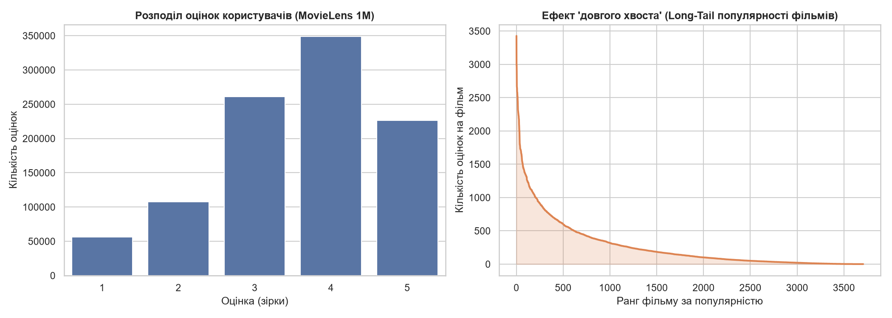
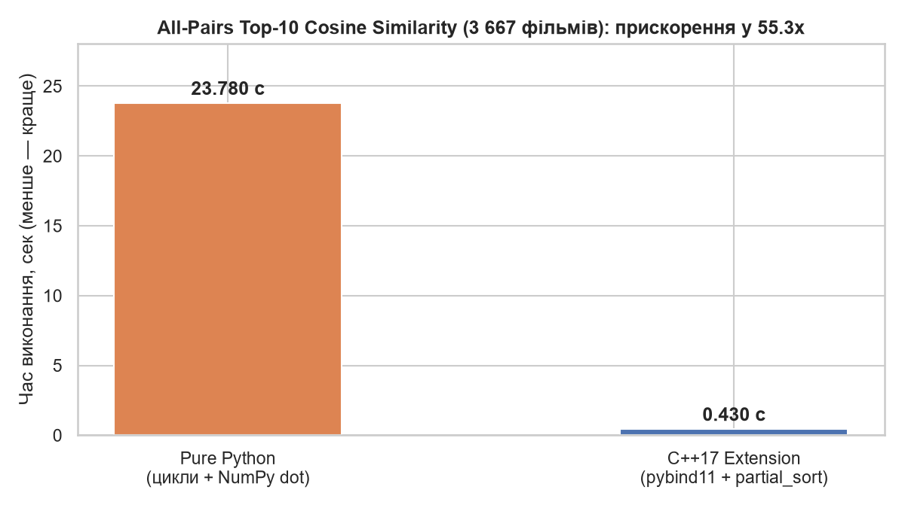

# MovieLens 1M Recommendation System (Matrix Factorization + C++17 Extension)


Рекомендаційна система персоналізованих рекомендацій фільмів та пошуку схожих стрічок на відкритому датасеті **MovieLens 1M** (**1 000 209** оцінок, **6 040** користувачів, **3 667** фільмів). Проєкт поєднує роботу з розрідженими матрицями (`SciPy CSR`), алгоритми колаборативної фільтрації (`Truncated SVD` та `Implicit ALS`), оцінку якості ранжування (`Precision@K`, `NDCG@K`) та високопродуктивне обчислювальне ядро на **C++17 (`pybind11`)**.

---

## Ключові результати

* **Економія оперативної пам'яті у 13.8 раза (`SciPy CSR`):** при розрідженості матриці взаємодій **96.40%** перехід від щільного формату (`float32`, **84.49 МБ**) до стисненого рядкового формату `csr_matrix` зменшив обсяг пам'яті до **6.11 МБ**.
* **Валідація без витоку даних (*Temporal Split*):** для кожного користувача останні **20%** оцінок за `Timestamp` відкладено у тестову вибірку (`test_matrix.npz`), а попередні **80%** використано для навчання (`train_matrix.npz`). Оцінка якості проведена на **5 974** користувачах із релевантними оцінками ($\ge 4.0$).
* **Перемога `Implicit ALS` у задачах ранжування (`K = 10`):** модель перевершила централізований `Truncated SVD` за обома метриками (`Precision@10 = 0.0899`, `NDCG@10 = 0.1093`).
* **Прискорення обчислень на C++17 у 53.5 раза (`pybind11`):** пошук *All-Pairs Top-10* найближчих сусідів за косинусною подібністю на матриці латентних факторів ($3667 \times 64$) скоротився з **22.901 с** (Pure Python) до **0.428 с** (C++17).

---

## Архітектура та інженерні рішення

1. **Пайплайн даних (`src/data_loader.py`):**
   * Парсинг сирих `.dat`-файлів (`latin-1`, роздільник `::`), побудова неперервних індексів (`id_mappings.json`) та персональний часовий поділ вибірки.
   * Збереження матриць у форматі `SciPy CSR` для швидкого построкового доступу до історії переглядів користувачів.

2. **Моделі колаборативної фільтрації (`src/models.py`):**
   * **`Truncated SVD` (бейзлайн):** розклад матриці через `scipy.sparse.linalg.svds` ($64$ фактори) із попереднім центруванням оцінок за середнім балом кожного користувача (щоб непереглянуті фільми трактувалися як нейтральний `0`, а не негативна оцінка).
   * **`Implicit ALS` (основна модель):** факторизація матриці впевненості через `implicit.als.AlternatingLeastSquares` (`factors=64`, `alpha=15.0`, `regularization=0.05`, `iterations=20`) на позитивних взаємодіях ($\text{Rating} \ge 4.0$) із фільтрацією всіх раніше переглянутих фільмів під час інференсу.

3. **Нативне прискорення на C++17 (`cpp/similarity.cpp`):**
   * **Zero-copy доступ до пам'яті:** пряме читання буфера `NumPy`-масиву `float32` через `embeddings.unchecked<2>()` без копіювання даних.
   * **Попереднє кешування норм:** одноразовий розрахунок $L_2$-норм векторів перед попарним порівнянням.
   * **Часткове сортування:** використання `std::partial_sort` замість повного сортування знижує асимптотичну складність відбору топ-$K$ сусідів із $O(N \log N)$ до $O(N \log K)$.

---

## Експериментальні результати

### Порівняння моделей (`K = 10`)

| Модель | Precision@10 | NDCG@10 | Оцінені користувачі | Час навчання |
| :--- | :---: | :---: | :---: | :---: |
| **Truncated SVD** (`scipy.sparse.linalg.svds`) | 0.0885 | 0.1048 | 5 974 | 0.39 с |
| **ALS** (`implicit.als.AlternatingLeastSquares`) | **0.0899** | **0.1093** | 5 974 | 0.88 с |

### Бенчмарк пошуку схожих фільмів (*All-Pairs Top-10*, $3667 \times 64$)

| Реалізація | Час виконання | Прискорення |
| :--- | :---: | :---: |
| **Pure Python** (цикли + `NumPy` dot) | 22.901 с | 1.0x |
| **C++17 Extension** (`pybind11` + `std::partial_sort`) | **0.428 с** | **53.5x** |

### Візуалізація аналізу та бенчмарку





---

## Структура проєкту

```text
movielens-recsys/
├── cpp/
│   ├── similarity.cpp             # C++17 розрахунок косинусної подібності та Top-K (pybind11)
│   └── setup.py                   # Збірка C++-розширення у пакет src
├── data/
│   ├── raw/ml-1m/                 # Сирі .dat файли MovieLens 1M (ігнорується Git)
│   └── processed/                 # Розріджені матриці train/test (.npz) та мапінги ID
├── models/
│   └── metrics_summary.json       # Збережені метрики моделей та результати бенчмарку
├── notebooks/
│   ├── 01_eda_and_sparsity.ipynb  # EDA: розподіл оцінок, long-tail ефект та розрідженість
│   └── 02_svd_als_eval.ipynb      # Порівняння SVD/ALS, Precision@K, NDCG@K та бенчмарк C++
├── reports/figures/               # Графіки для аналізу та документації
├── src/
│   ├── config.py                  # Шляхи до файлів та гіперпараметри
│   ├── data_loader.py             # Парсинг .dat, часовий спліт, побудова SciPy CSR-матриць
│   ├── metrics.py                 # Реалізація Precision@K та NDCG@K
│   ├── models.py                  # Класи SVDRecommender та ALSRecommender
│   └── recommend.py               # CLI-модуль генерації рекомендацій та схожих фільмів
├── requirements.txt
└── README.md
